# AI Procurement Intelligence

**Spend analytics, anomaly detection and supplier risk on 1.5 million French public contracts, with AI explanations that a reviewer validates.**

[](https://ai-procurement-intelligence.streamlit.app)
[](https://github.com/Thierry-Daconceicao-Alvares/ai-procurement-intelligence/actions/workflows/ci.yml)


[](LICENSE)

<p align="center">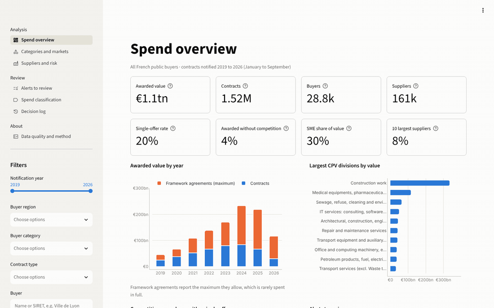</p>

**Try it: [ai-procurement-intelligence.streamlit.app](https://ai-procurement-intelligence.streamlit.app)**
(public demo: AI explanations generated in advance, decisions kept for your session only).

French public buyers publish the contracts they award: the consolidated file
holds 3.3 million rows, open to anyone, and messy. The same award is often
published several
times, framework agreements are published once per supplier, and some amounts
are placeholders such as €999,999,999: summed as published, the amounts reach
€14.0 trillion, more than ten times the value that survives cleaning.

This project turns that data into a reliable spend cube, then answers the
questions a procurement team asks: where the money goes, which prices look
wrong, where competition fails, which suppliers carry a risk, and which
contracts are filed in the wrong category. Each finding is an alert with its
evidence; a language model explains it in plain English, every figure it
writes is checked against the data, and the reviewer records a decision in an
audit log.

## Key results

- **€1.10 trillion awarded through 1.52 million contracts** (January 2019 to
  September 2026), after merging 287,839 records that repeat an award and
  setting aside 12,448 implausible amounts.
- **Amount errors**: on unit errors injected into real contracts, the model
  of expected amounts finds 83% of the amounts multiplied by 1,000 and
  88% of those divided by 1,000, against 54% and 63% for a
  segment benchmark, while it sets aside 0.2% of the published amounts.
- **Spend classification**: 78.8% accuracy (92.1% top-3) on 297,339
  descriptions of 2025-2026 never seen in training, against 76.0% for a
  naive Bayes baseline. Wrong codes are flagged with a strict rule, for
  precision: it flags 0.4% of the contracts and finds 14% of the
  wrong codes injected; a looser threshold finds 71% for 4.6%.
- **318,343 alerts** in five categories, ordered by severity and amount at
  stake, each with its evidence, a recommended action and its legal
  reference.

All figures come from [`reports/metrics/`](reports/metrics) and are
reproducible from the frozen data snapshot: see [results](docs/results.md).

## What it does

| Question | How | Where |
|---|---|---|
| Where does the money go? | Star schema of contracts, buyers, suppliers and CPV categories; spend by year, category and buyer; supplier concentration (top 10, HHI) | Spend overview, Power BI |
| Which amounts look wrong? | Rules for placeholders and out-of-range amounts, then a LightGBM model of the expected amount, cross-fitted, with robust z-scores | Alerts: price and amount drift, data quality |
| Where does competition fail? | Single offers above the EU thresholds, buyers with a high single-offer rate, awards without competition above the legal threshold, possible splitting | Alerts: value leakage |
| Which suppliers carry a risk? | Dependency on one supplier, ceased or newly created companies (Sirene), unusual activity for the category; k-means supplier segments; Kraljic matrix of markets | Suppliers and risk, categories |
| Is the spend in the right category? | TF-IDF and linear classifier of descriptions into 45 CPV divisions; flags of very unlikely codes | Spend classification |
| What should the reviewer do? | Deterministic recommended action and legal reference per alert; explanation by Gemini with every figure verified; decisions appended to an audit log with the hash of the evidence | Alerts to review, decision log |

<p align="center">
  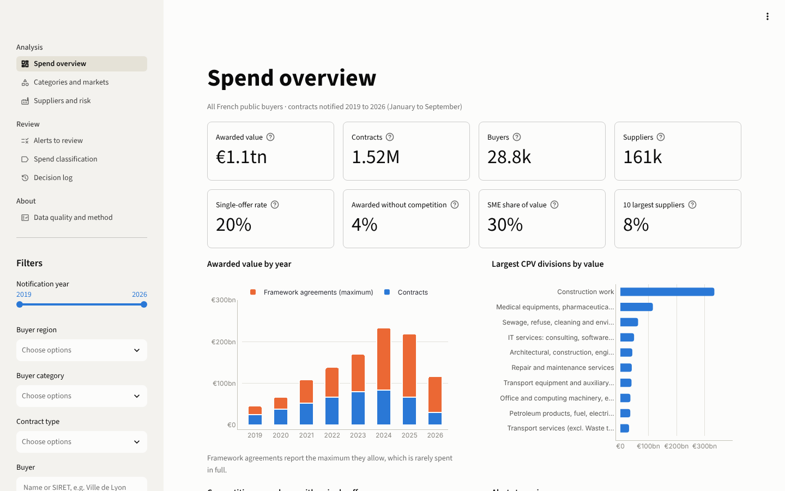
  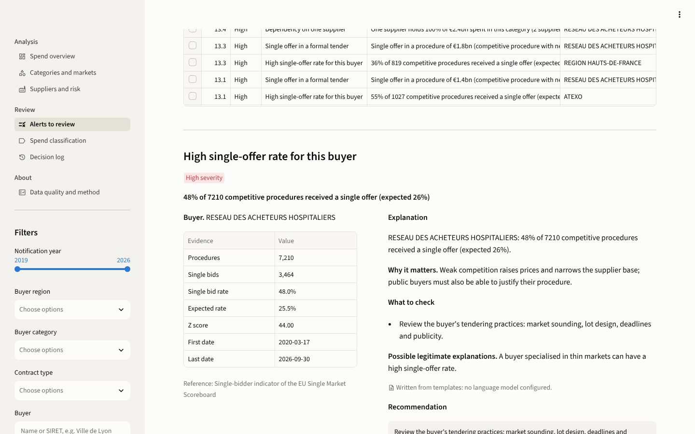
</p>

<details>
<summary>More pages of the application</summary>

| Categories and markets | Suppliers and risk |
|---|---|
| 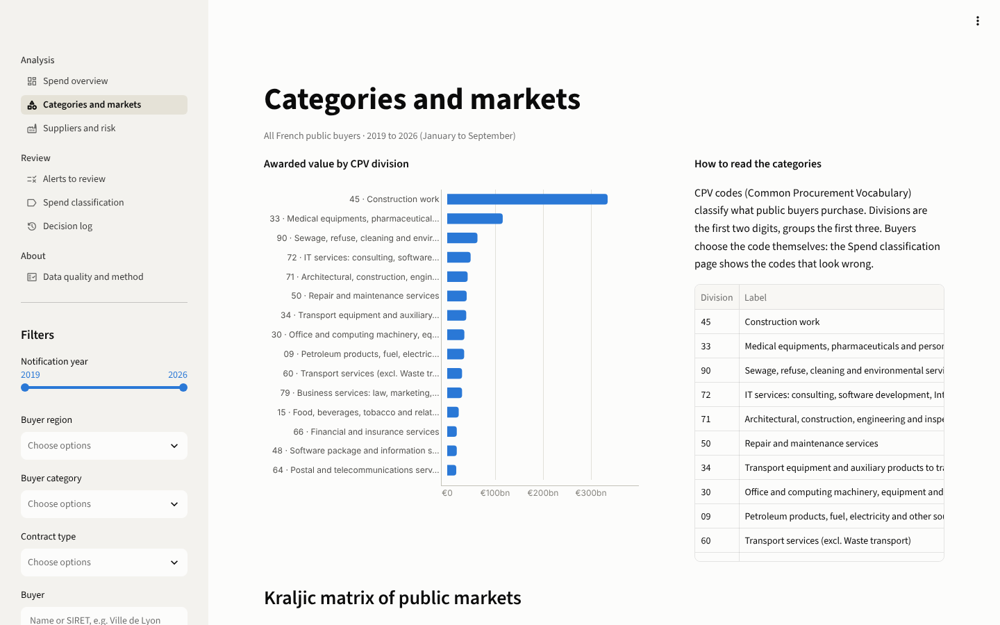 | 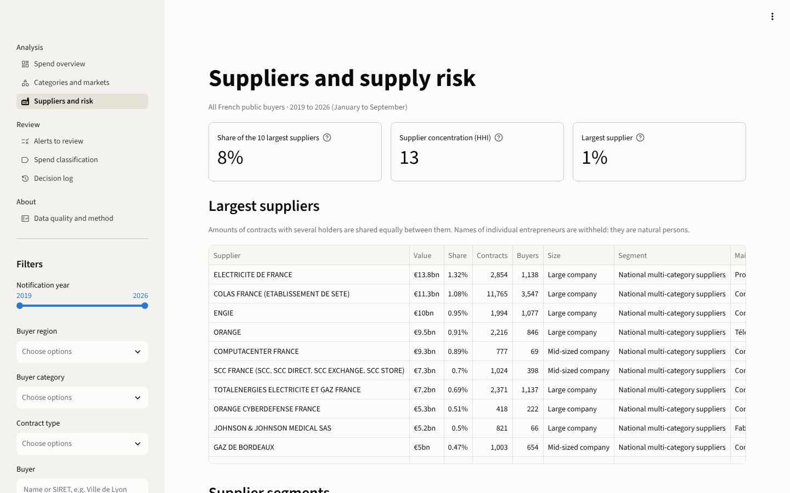 |
| **Spend classification** | **Data quality and method** |
| 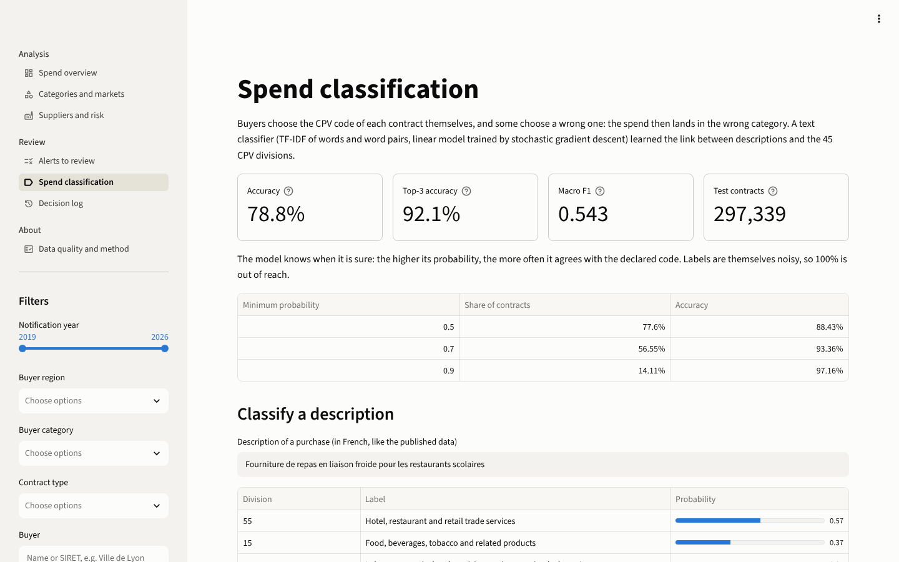 | 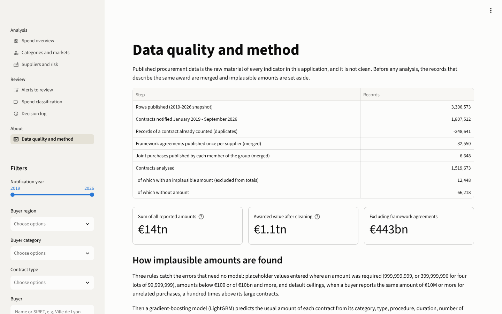 |

</details>

<details>
<summary>The Power BI report on the same marts</summary>

| Spend overview | Suppliers and supply risk |
|---|---|
| 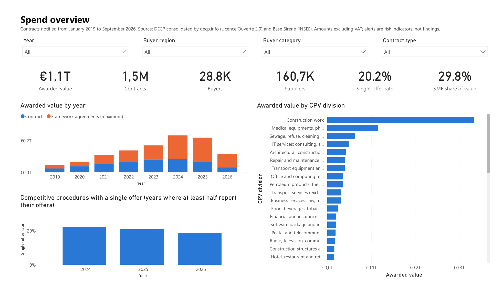 | 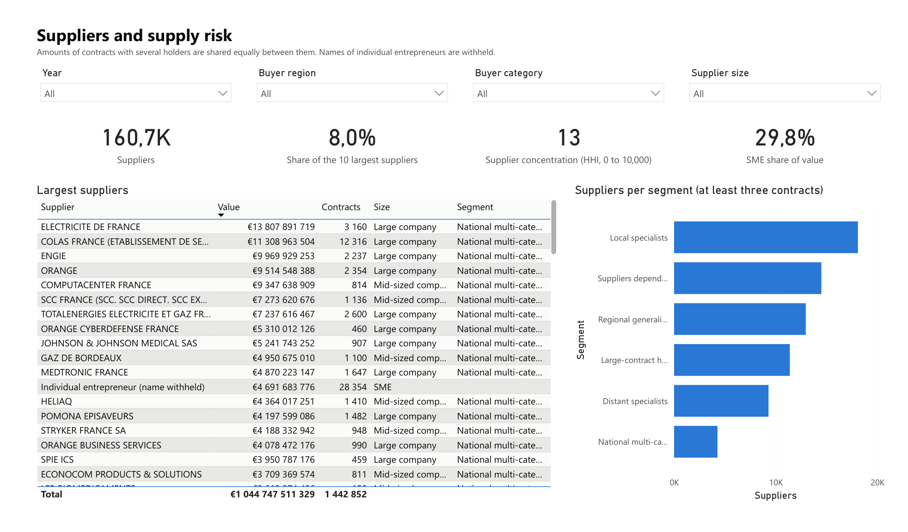 |
| **Categories and markets** | **Alerts to review** |
| 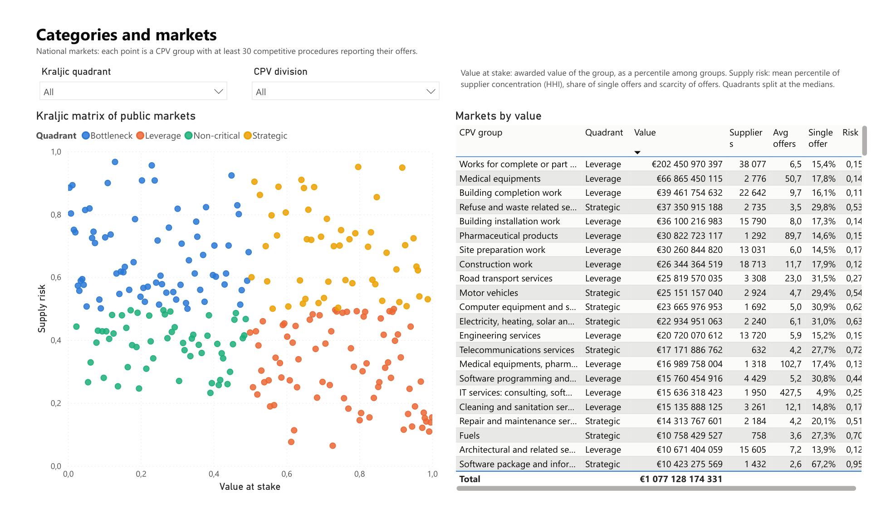 | 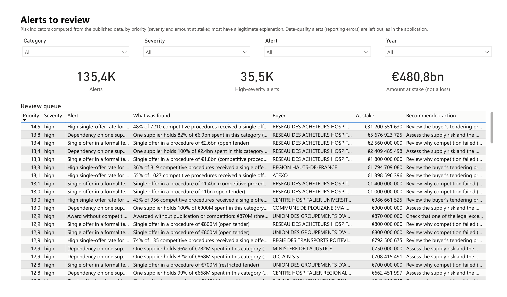 |

</details>

## Architecture

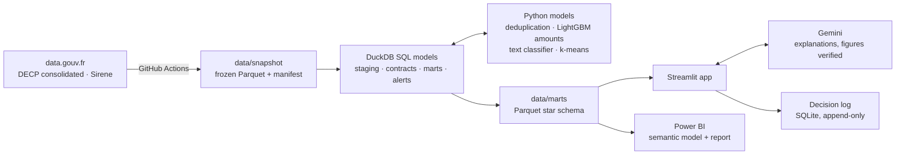

The build (`python -m procurement_intel build`) runs SQL models and Python
steps in order: staging, one row per contract, merge of the records of one
award, amount checks, marts, alert detectors, classifier, segments, export.
The application and Power BI read only the exported marts. Method:
[docs/method.md](docs/method.md).

## Quick start

The marts and the classifier are committed: the application runs without
rebuilding anything.

```bash
git clone https://github.com/Thierry-Daconceicao-Alvares/ai-procurement-intelligence.git
cd ai-procurement-intelligence
python -m venv .venv && source .venv/bin/activate   # Windows: .venv\Scripts\activate
pip install -r requirements.txt
streamlit run app/streamlit_app.py
```

Live explanations need a Gemini API key (`GEMINI_API_KEY` in the environment
or a `.env` file); without one, the application shows the explanations
generated in advance or written from templates. Deployment on Streamlit
Community Cloud or Docker: [docs/deployment.md](docs/deployment.md).

Rebuild everything from the data snapshot and run the tests:

```bash
pip install -e ".[app,build,dev]"
python -m procurement_intel build      # about 16 minutes
python -m procurement_intel evaluate   # injected errors
python scripts/write_results.py        # docs/results.md
pytest
```

Power BI: open `powerbi/ProcurementIntelligence.pbip` in Power BI Desktop and
set the `DataFolder` parameter ([docs/powerbi.md](docs/powerbi.md)).

## Data

| Source | Licence |
|---|---|
| [Données essentielles de la commande publique, consolidated](https://www.data.gouv.fr/datasets/608c055b35eb4e6ee20eb325) by Colin Maudry (decp.info), from the data published by French public buyers | Licence Ouverte 2.0 |
| [Base Sirene, stock of legal units](https://www.data.gouv.fr/datasets/5b7ffc618b4c4169d30727e0) (INSEE) | Licence Ouverte 2.0 |
| CPV 2008 code list, eForms SDK of the Publications Office of the European Union | CC BY 4.0 |

The workflow "Build the data snapshot" downloads the sources and freezes them
in `data/snapshot/`, with a manifest of URLs, dates and SHA-256 checksums
(snapshot of 19 October 2026). The Sirene extract keeps only contract holders
and no name; the names of individual entrepreneurs, who are natural persons,
are withheld everywhere.

## Evaluation

Published data has no labels, so each part is evaluated in the way its output
can be checked ([docs/evaluation.md](docs/evaluation.md)):

- **Amounts**: known unit errors are injected into 20,000 typical contracts and
  the whole detection runs again; recall per type of error, against a segment
  benchmark.
- **Classification**: a test set in the future (2025-2026, unseen
  descriptions), and wrong codes injected to measure the flag rule.
- **Deduplication**: tests on constructed cases (truncated descriptions, lots,
  joint purchases).
- **Explanations**: every figure of every generated text checked against the
  evidence; verification rate, latency, tokens and cost recorded.
- **Alerts**: the decisions of the reviewers, per alert type, are the measure of
  precision that the data cannot give.

The project has 121 tests (`pytest`), run by CI with linting (Ruff), a
Docker build and the validation of the Power BI project.

## Limitations

- **Awarded, not spent.** Amounts are awarded amounts; framework agreements
  report a maximum that is rarely spent in full. Payments are not in this data.
- **Coverage.** Not every buyer publishes its contracts, recent months are
  incomplete, and the number of offers is reported for most competitive
  procedures only since 2024: the single-offer rate of earlier years is not
  comparable.
- **Merging records is a heuristic.** The rules for duplicates and joint
  purchases are conservative and tested, but some repeated records remain and
  a few distinct contracts with identical terms may be merged. A joint
  purchase is kept under one buyer, usually the coordinator: the members'
  shares are not published.
- **The amount model sees only the published data.** It cannot tell a real
  billion-euro framework agreement from a typing error at a buyer that awards
  both; its spread per buyer protects central purchasing bodies but makes
  errors less visible at buyers whose amounts vary a lot.
- **Thresholds by notification date.** The law applies thresholds from the
  launch of the consultation, which the data does not give.
- **Alerts are indicators.** Most have a legitimate explanation that only the
  buyer's file can show; no alert is a finding of wrongdoing.
- **The language model explains, it does not decide.** The figure check covers
  numbers, not reasoning; explanations are shown next to their evidence, and
  the recommendation the reviewer validates comes from the alert catalogue.

## Possible improvements

- Feed the reviewers' decisions back into the thresholds and the priority
  score (precision per alert type, learned priority).
- Resolve buyers and purchasing groups (SIRET to SIREN, members of a group) to
  allocate joint purchases between their members.
- Add payment data where published (budget execution of local authorities) to
  compare awarded and spent amounts.
- Compare unit prices: the published data gives one amount per contract, not
  its line items, which would need another source (orders or invoices).
- Incremental refresh of the snapshot and of the marts, and data contracts on
  the sources.
- Evaluate the explanations with procurement reviewers (usefulness, errors),
  beyond the automatic figure check.

## Repository

```text
app/                      Streamlit application (pages in app/views/)
src/procurement_intel/    pipeline: SQL models, deduplication, amount model,
                          classifier, segments, alerts, LLM, decision log
data/snapshot/            frozen open data with its manifest
data/marts/               Parquet marts read by the application and Power BI
models/                   compact classifier used by the application
reports/metrics/          metrics of every model and evaluation (JSON)
powerbi/                  Power BI project (TMDL semantic model, PBIR report)
reference/                CPV list and procurement thresholds with sources
docs/                     method, evaluation, results, deployment, Power BI
tests/                    unit, SQL and application tests
```

## License

Code under the [MIT License](LICENSE). Data under the Licence Ouverte 2.0
(DECP, Sirene) and CC BY 4.0 (CPV).

Author: [Thierry Daconceição Alvares](https://www.linkedin.com/in/thierry-alvares/)
